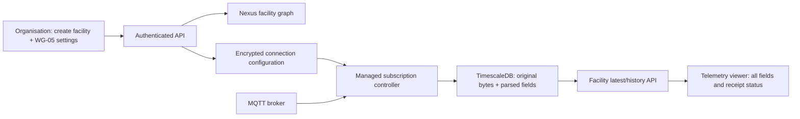

# Facility MQTT telemetry

## Decision and evidence

Use Nexus for organisation/facility identity and TimescaleDB (PostgreSQL with the
Timescale extension) for MQTT connection configuration and append-only readings.
The API owns a background subscription controller; opening a browser never starts
or generates a reading. A database advisory lock elects one ingestion controller
when multiple API instances run. Each facility owns one gateway subscription;
individual meters are discovered from the payload's `DEVID`.

The existing implementation fabricates an EM6400 reading on every HTTP request,
automatically creates a Sattric meter for every facility, and loads a benchmark
when the UI cannot reach telemetry. None of those behaviours establishes a real
device connection. Replace that production path, including the separate 8085
simulator. Existing registrations are not automatically assigned a real gateway.

## Connection fields

| Field | Supplied value / meaning |
| --- | --- |
| Device | SaurEdge/WG-05, the selected gateway integration; not the downstream meter model |
| Host | `15.207.187.242`, address of the MQTT broker, not a meter IP |
| Port | `1883`, the supplied plain TCP listener |
| TLS | Off for this endpoint; enable only for a broker TLS listener |
| Username | `test`, broker authentication identity |
| Password | Enter at onboarding; encrypted with AES-GCM at rest; never returned by the API |
| Topic | `INSTRUTEL/MBIOT_ETH/09001/EMS`, exact subscription topic |
| Gateway serial | `09001`; must match the payload `SNO` |
| QoS | Default 0, matching the PoC; request 1 only after provider confirmation |

The same broker/topic/serial cannot be assigned to another facility. A gateway
carrying several physical facilities will require explicit per-meter bindings in
a later schema; it must not be assigned wholesale to each facility.

## Payload dictionary: observations versus interpretation

Evidence is the three local captures described in `mqtt_subscriber_poc.md`.
Definitions and scaling are **not vendor-confirmed**. Preserve raw values;
do not silently map this payload into the older EM6400 schema.

| Field | Observed example | Working interpretation / unresolved point |
| --- | --- | --- |
| `LOC` | `HYDERABAD` | Location label; not an authoritative facility assignment |
| `SNO` | `09001` | Gateway/site identifier; preserve leading zeroes |
| `DEVID` | `0001`, `0003`, `0004` | Meter identifier within a gateway; preserve leading zeroes |
| `COMM` | `"1"` | Communication code; success/failure semantics unconfirmed |
| `INST` | `LG+5310` | Instrument identifier/model label; vendor confirmation required |
| `RV`, `YV`, `BV` | `227.89`, `222.63`, `232.27` | Likely R/Y/B voltage; V, scaling and line-neutral versus line-line unconfirmed |
| `RWt`, `YWt`, `BWt` | `320.94`, `258.7`, `270.58` | Likely per-phase active power; W versus kW and scaling unconfirmed |
| `TWt` | `850.22` | Likely total active power; sample equals sum of phase values; units unconfirmed |
| `RA`, `YA`, `BA` | `92.07`, `46.97`, `25.45` | Likely phase current; units and CT multiplier unconfirmed |
| `RPF`, `YPF`, `BPF` | `0.91`, `0.97`, `0.95` | Likely phase power factors; sign convention unconfirmed |
| `PF` | `0.98` | Likely aggregate power factor; aggregation unconfirmed |
| `Freq` | `47.63` | Likely frequency; units unconfirmed; unusual observed values need investigation |
| `kWh` | `53357.77` | Energy-labelled value; cumulative/interval, import/export, multiplier and reset behaviour unconfirmed |

In particular, the sample voltage/current/power values are not sufficient to
validate a physical model. No timestamp, timezone, sequence or event ID appears.
Receipt at the server is not proof of a fresh physical measurement.

## Storage and lifecycle

`telemetry_sources` stores tenant/facility ownership, stable source ID, connection
settings, encrypted credentials and a revision. `telemetry_messages` is a
hypertable partitioned by `received_at`, indexed by tenant/facility/meter/time.
It stores exact bytes (including malformed payloads), JSON fields when decodable,
parse errors, topic, delivery QoS, retained/duplicate flags, and source identity.
No numeric conversion, power inference, cumulative differencing or emissions
calculation is enabled. Unknown fields are retained and visible.

On startup and every reconciliation interval, the controller reloads sources,
starts new subscriptions and replaces changed ones. Facility deletion removes
the source; the controller cancels its worker. Historical readings remain for
audit. Disconnects and rejected subscriptions retry with backoff; successful
reconnects resubscribe. Database writes retry before acknowledging QoS 1 messages.
The in-memory queue is bounded and applies backpressure.

QoS 0 cannot guarantee delivery during outages or process crashes. With no event
ID or device time, identical payloads can be either redelivery or legitimate
unchanged readings. Keep every delivery and its duplicate flag; do not claim
exactly-once semantics or deduplicate by payload hash. Retained deliveries remain
visible as retained and never prove measurement freshness. Broker persistent
sessions can improve QoS 1 recovery but require vendor-supported QoS and broker
retention. Configure a retention policy only after the audit retention period is
agreed; this change does not automatically delete readings.

Facility creation and source persistence span two stores. Persist the facility
first, then its source, and report a source-save failure explicitly. Retry with
the same facility ID; do not silently show an unsaved facility as connected.
Only enable subscriptions for saved Nexus facilities. Device status represents
subscription/storage state, separate from measurement freshness. The stale
threshold is configurable and refers only to server receipt time.

## Connecting this feed to carbon calculations

The existing product/rulebook calculation path continues to accept its activity
inputs. This raw feed must not populate those inputs automatically yet. After
vendor confirmation, introduce a versioned WG-05 decoder with explicit units,
CT/PT multipliers, communication-quality rules, and device observation time if
the provider can supply it. Keep the original delivery alongside every derived
measurement and record the decoder version.

If `kWh` is confirmed cumulative, calculate differences only within the same
gateway/meter/counter identity; handle counter resets, rollover and missing
intervals explicitly. If it is interval energy, preserve the provider's interval
boundaries. A facility also needs a documented meter-to-process/batch allocation
before energy can become batch activity data. Attach those allocations and raw
message references to calculation lineage. Approved emission factors and the
existing rulebook engine then operate on validated energy activity, rather than
on instantaneous power or an unexplained raw counter.

## Validation and operational boundaries

Use local MQTT fixtures and an opt-in TimescaleDB integration test. Check raw
byte preservation, malformed messages, multi-meter routing, encrypted credential
round trips, tenant isolation, rejected subscriptions, cancellation and source
restarts. Live provider observation is read-only and does not publish commands.

For production, use TLS on a provider-supported endpoint and manage the database
password and encryption key as deployment Secrets. Back up both the database and
the encryption key. The API's database role needs extension/schema creation for
the initial migration; managed deployments can provision these separately.

Primary references: [Timescale hypertables](https://www.tigerdata.com/docs/reference/timescaledb/hypertables/create_table)
and [Paho client options](https://github.com/eclipse-paho/paho.mqtt.golang/blob/v1.5.1/options.go).
